# 🎣 Fishing Bite Sensor

[Русская версия](README_RU.md)

**A wireless bite alarm for fishing rods.** A small sensor on the rod notices even weak line pulls, signals locally with LEDs and a buzzer, and reports the bite over ESP-NOW radio to a **hub**: a receiver with a screen and a vibration motor that stays next to you. No router, Internet or app is needed; all settings open in your phone's browser.

<p align="center">
  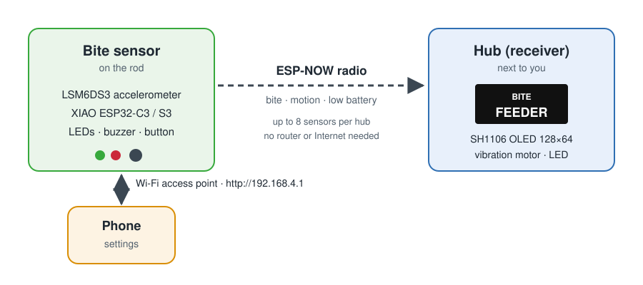
</p>

> **Project status.** This is a bench release: the firmware is covered by tests and has run on real XIAO ESP32-C3 boards (sensor + hub), but it **has not been tried on real fishing trips yet**. Bite-detection accuracy, radio range and battery life have not been measured.

## Contents

- [Features](#features)
- [What you need](#what-you-need)
- [Wiring](#wiring)
- [Installing the firmware](#installing-the-firmware)
- [Pairing the sensor with the hub](#pairing-the-sensor-with-the-hub)
- [Web interface](#web-interface)
- [Using it on the water](#using-it-on-the-water)
- [Button, sleep and wake](#button-sleep-and-wake)
- [Signals and states](#signals-and-states)
- [Hub](#hub)
- [Tuning sensitivity](#tuning-sensitivity)
- [Battery](#battery)
- [Troubleshooting](#troubleshooting)
- [For developers](#for-developers)

## Features

**Rod sensor**

- 🎯 **Sensitive detection.** The LSM6DS3 accelerometer is read 104 times per second. The *Dynamic XYZ* algorithm removes gravity and reacts to a jolt in any direction, including across the rod.
- 🔇 **Wind protection.** The sensor reacts to the **sharp** jolt of a bite and ignores the smooth vibration wind gives the rod. The wind level is tracked continuously over the last 10 seconds, so a gust does not raise a false alarm and full sensitivity comes back in calm.
- 🎣 **Pause while handling the rod.** When you pick up or tilt the rod, alarms pause. Once the rod is still again in its **new** position, the sensor re-arms by itself.
- 🔔 **Local signals.** Whenever the sensor is awake (armed or not) the red LED gives a short flash every 5 seconds, so you can tell it from deep sleep, where everything is dark. While armed the green LED is also on. A bite is red LED plus buzzer. Volume is adjustable.
- 📡 **ESP-NOW radio to the hub.** Three events: first bite, continuing bite, low battery.
- 📱 **A simple web page.** The sensor runs its own Wi-Fi access point with a page at `http://192.168.4.1`: state, arming, sensitivity (5 steps), volume. Everything else is in the *Settings* menu.
- 🔘 **One button** for arming, disarming, deep sleep and wake.
- 🔋 **Battery saving.** The sensor sleeps on a button hold or by itself after 3 idle minutes. A brush against the button in a bag does not wake it. Below 3.30 V it also goes to sleep to protect the cell.
- 💾 **Settings are kept** in flash and survive firmware updates.
- 🧾 **Event journal.** The sensor records what it decided and why: button presses, calibrations, arming. Read it over USB with `log`.

**Hub (receiver)**

- 🖥️ 128×64 OLED with a Cyrillic font: the name of the rod that has a bite, in large letters.
- 📳 Vibration motor with different patterns for a bite, a continuing bite and a sensor's low battery.
- 🎣 Up to 8 sensors per hub, log of the last 12 events.
- 🌙 The start-up screen (with the hub MAC) stays on for 20 seconds, then turns off and wakes only for a new alert.
- 🔘 Button: hold 1.5 s to show the hub MAC for pairing, short press for the status screen.

## What you need

| Device | Parts | Notes |
|---|---|---|
| **Sensor** | Seeed XIAO ESP32-C3 (bench) or XIAO ESP32-S3 (PCB v4), LSM6DS3 module (I²C), green and red LEDs, passive buzzer (through a transistor), momentary push button, 3.7 V Li-ion cell, 100 kΩ / 100 kΩ battery divider | A KiCad v4.1 board and an 18650 enclosure are in [`kicad/kicad_bite`](kicad/kicad_bite) |
| **Hub** | XIAO ESP32-C3 or S3, SH1106 128×64 OLED (I²C), vibration motor through a MOSFET, push button, LED, Li-ion cell, 100 kΩ / 100 kΩ divider | Separate firmware in [`ESP_HUB/`](ESP_HUB). Circuit and parts: [docs/hub-hardware.md](docs/hub-hardware.md) (Russian) |
| **Phone** | Any smartphone with Wi-Fi and a browser | Only for configuration |
| **Computer** | [PlatformIO](https://platformio.org/install), USB-C cable | For flashing |

<p align="center">
  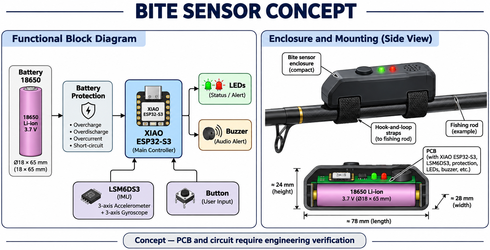
  <br><em>Concept: the sensor in a compact case, strapped to the rod with hook-and-loop straps.</em>
</p>

<p align="center">
  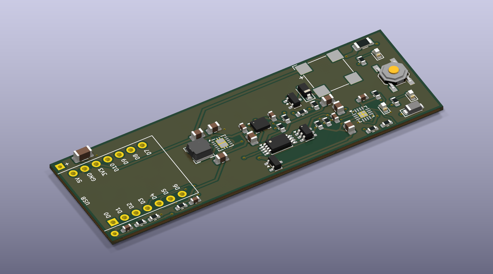
  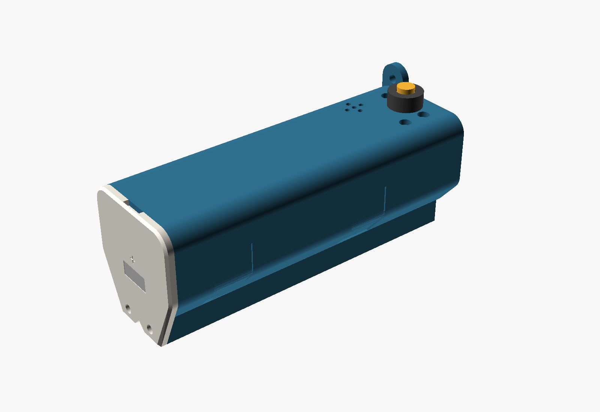
  <br><em>PCB v4.1 and the sealed tube enclosure for an 18650 cell (design files; not yet built or tested).</em>
</p>

## Wiring

### Sensor — bench (XIAO ESP32-C3 / S3)

| Signal | XIAO pin | Notes |
|---|---|---|
| Button | **D1** | To GND; internal pull-up |
| Battery (100k/100k divider) | D2 | |
| LSM6DS3 SDA / SCL | D4 / D5 | Module powered from 3.3 V |
| Green LED | D7 | Through a resistor or driver |
| Red LED | D8 | Through a resistor or driver |
| Passive buzzer | D9 | Through a transistor; 3 kHz PWM |

The button must be on **D1**: the board cannot wake from deep sleep on D6. D0 and D6 are unused by the current firmware.

### Sensor — Waveshare ESP32-S3-Zero (environment `s3_zero`)

This board labels its pins by GPIO number (GP1…GP13), not D0…D10, so the wiring is given in GPIO numbers:

| Signal | GPIO | Notes |
|---|---|---|
| LSM6DS3 SDA / SCL | GP4 / GP5 | Module powered from 3.3 V |
| Button (to GND) | GP6 | Wakes from deep sleep; internal pull-up |
| Battery (100k/100k divider) | GP7 | |
| Green LED | GP8 | |
| Red LED | GP9 | |
| Passive buzzer (through a transistor) | GP10 | 3 kHz PWM |

Do not use GP0 (BOOT button), GP3 (affects boot), GP21 (on-board RGB LED), GP19/GP20 (USB) or TX/RX (GP43/GP44). **The ESP32-S3-Zero has no battery charger or BAT pads:** connect a Li-ion cell through a separate charge/protection module to the 5V pin and take the divider from the cell. Check against Waveshare's schematic for your board revision: the pinout above is verified by building the firmware only, not on the board itself.

### Sensor — PCB v4 (XIAO ESP32-S3, environment `bite_v4_s3`)

Button D1 (external 10k pull-up), battery D0, red LED D8, green LED D9, buzzer D10, LSM6DS3 on D4/D5.

### Hub

| Signal | XIAO pin | Waveshare ESP32-S3-Zero (`s3_zero`) |
|---|---|---|
| OLED SDA / SCL | D4 / D5 | GP4 / GP5 |
| LED | D1 | GP8 |
| Motor MOSFET | D2 | GP9 |
| Button (to GND) | D3 | GP6 |
| Battery (100k/100k divider) | A0 | GP7 |

<p align="center">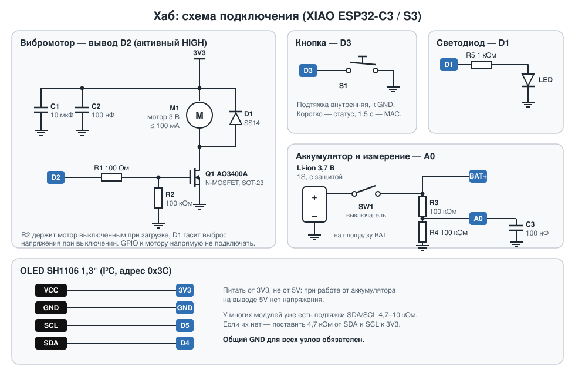</p>

Choosing and wiring the vibration motor, with the parts list: [docs/hub-hardware.md](docs/hub-hardware.md) (Russian). In short: an AO3400A MOSFET with 100 Ω gate resistor and 100 kΩ gate pull-down, an SS14 flyback diode across the motor, 10 µF + 100 nF on the motor supply, motor powered from 3V3.

> ⚠️ Drive the motor and any loud buzzer through a transistor, never straight from a pin. Connect the Li-ion cell to the XIAO **BAT+ / BAT−** pads, not to 3V3. Power details: [docs/power-and-wiring.md](docs/power-and-wiring.md).

## Installing the firmware

1. **Install PlatformIO**, either [PlatformIO IDE for VS Code](https://platformio.org/install/ide?install=vscode) or the [PlatformIO Core CLI](https://docs.platformio.org/en/latest/core/installation/index.html). Make sure `pio --version` works.

2. **Get the project.**

   ```bash
   git clone https://github.com/igorvin/Fishing-Bite-sensor-ESP.git
   ```

   ```bash
   cd Fishing-Bite-sensor-ESP
   ```

3. **Flash the sensor.** Connect the sensor board over USB and pick the environment for your board. `<PORT>` is the board's port, e.g. `/dev/ttyACM0` or `COM5`.

   | Board | Environment |
   |---|---|
   | XIAO ESP32-C3 (bench) | `xiao_esp32c3` |
   | XIAO ESP32-S3 (bench) | `seeed_xiao_esp32s3` |
   | PCB v4 (XIAO ESP32-S3) | `bite_v4_s3` |
   | Waveshare ESP32-S3-Zero | `s3_zero` |

   ```bash
   pio run -e xiao_esp32c3 -t upload --upload-port <PORT>
   ```

4. **Flash the hub.** Connect the **other** board, the hub, and run:

   ```bash
   pio run -d ESP_HUB -e xiao_esp32c3 -t upload --upload-port <PORT>
   ```

   For a XIAO ESP32-S3 use `-e seeed_xiao_esp32s3`, for a Waveshare ESP32-S3-Zero `-e s3_zero`.

> 💡 Mind the ports: hub firmware on the sensor (or the other way round) will not work. For an ordinary update **do not** run `erase_flash` or `uploadfs`; they wipe the saved settings.

## Pairing the sensor with the hub

The sensor sends events only to the hub whose MAC address you give it.

1. **Find the hub's MAC.** It is on the bottom line of the start-up screen for 20 seconds after the hub is switched on. Holding the hub button for 1.5 seconds shows it in large digits for 30 seconds. Over USB: type `mac` in the hub's serial monitor.

   ```bash
   pio device monitor -d ESP_HUB --port <PORT> --baud 115200
   ```

2. **Give the MAC to the sensor**, in either of two ways:
   - **From the phone:** open the *Settings* menu, type the MAC into "Hub MAC" and press **"Save and restart"**. A filled-in MAC turns the hub link on by itself.
   - **Over USB:** in the sensor's serial monitor type `peer AA:BB:CC:DD:EE:FF` (the sensor must be disarmed).

3. **Check the link.** After the restart the sensor introduces itself to the hub. The sensor's page shows "Answered at power-on" in the Hub row, and the `status` command in the hub's serial monitor shows `rods=1`. Start-up order does not matter: if you restart the hub, a running sensor registers again.

> ℹ️ Registration is a one-off hello at start-up, not a continuous link check. Individual bites are not acknowledged. Before fishing, check that an alarm reaches the hub: arm the sensor and tap the rod.

## Web interface

1. Power on the sensor (or wake it by holding the button for about 1 s).
2. On your phone join the Wi-Fi network **`BiteSensor`** (the name on first start; no password).
3. Open **http://192.168.4.1** in the browser.

Everything fits on one page; the rarely used fields are in the **Settings** menu. Changes are saved at once; when something goes wrong (for example an ARM is cancelled) a pop-up message appears.

<table>
<tr>
<td align="center" width="50%">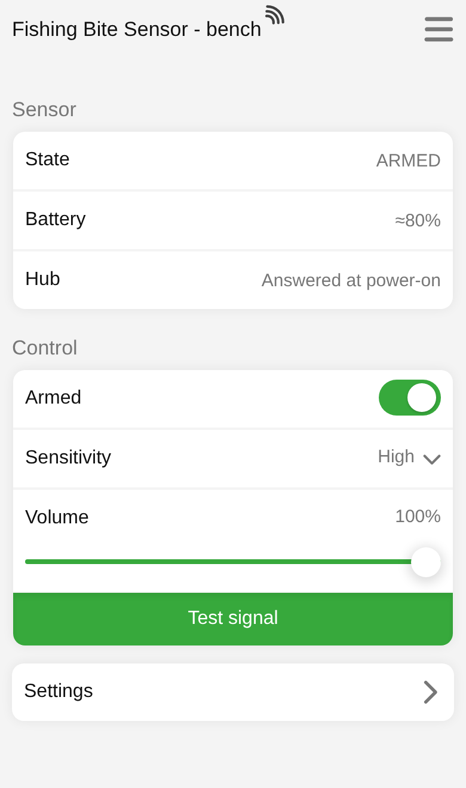<br><b>Main page</b></td>
<td align="center" width="50%">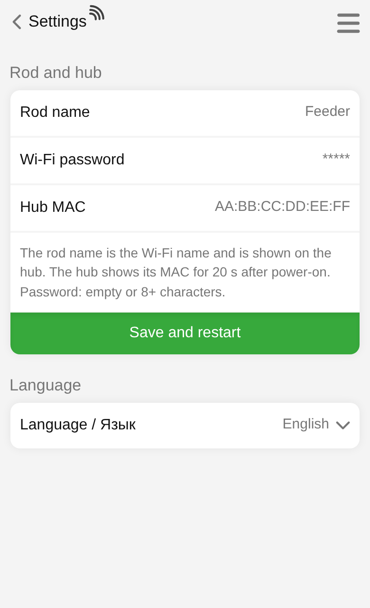<br><b>Settings</b></td>
</tr>
</table>

<sub>Pictures are taken from the firmware's real web front end (Settings library 1.4.3) with example values.</sub>

### Main page

| Item | What it shows or does |
|---|---|
| **State** | Off / Arming… / ARMED / Paused: rod is being moved / Calibrating… / Sensor error |
| **Battery** | Approximate charge in percent; "no reading" on USB power only |
| **Hub** | "Not set up" (enter its MAC) / "Waiting for the hub" / "Answered at power-on" / "Radio error" |
| **Armed** | Arms or disarms, like the button |
| **Sensitivity** | 5 steps, "High" by default (see below) |
| **Volume** | Buzzer volume, 0–100 % |
| **Test signal** | A short buzzer and red-LED signal. Nothing is sent to the hub |

| Sensitivity | Sharpness floor | Threshold in wind |
|---|---|---|
| Low | 0.030 g | wind level × 10 |
| Below medium | 0.022 g | × 8 |
| Medium | 0.016 g | × 7 |
| **High** (default) | 0.012 g | × 6 |
| Very high | 0.009 g | × 5 |

### Settings menu

| Setting | Description |
|---|---|
| **Rod name** | The sensor's Wi-Fi name and the name on the hub screen; the hub shows the first 16 bytes (16 Latin letters). Give each sensor its own name, e.g. "Feeder", "Carp-1" |
| **Wi-Fi password** | Empty (open) or 8–63 characters |
| **Hub MAC** | The hub's MAC as `AA:BB:CC:DD:EE:FF`. Empty means the hub link is off |
| **Save and restart** | Applies the three fields above. They have no effect until you press it |
| **Language / Язык** | English or Русский |

Everything else (signal timings, the movement pause with its 25° / 35° limits, LED brightness 100 %) runs on tested defaults. Technical data, the journal and raw capture are available over USB (see [USB commands](#troubleshooting)).

## Using it on the water

1. **Power on or wake the sensor.** Hold the button for about 1 second until it beeps. The sensor measures the background straight away, so **keep it still for 2 seconds**.
2. **Mount the sensor on the rod** and put the rod on its rest.
3. **Arm.** Hold the button for 1–3 seconds: a short beep sounds at 1 second, then release. The **green LED blinks** while the sensor checks for 1.5 seconds that it is *steady* (*SETTLING*): swaying in wind is fine, being handled or moved is not and restarts the check. When the green LED stays on and a **long beep** sounds, it is armed. Do not press again while green is blinking: a second press disarms. If the sensor has not been calibrated yet, it starts calibrating 1 second after you release the button (do not touch it for 2 seconds).
4. **Bite:** red LED and buzzer on the sensor, screen and vibration on the hub. The signal repeats while the line keeps moving.
5. **Picked up the rod?** No need to disarm: the sensor pauses alarms and re-arms by itself once the rod is still again, in its new position.
6. **Disarm** with the same 1–3 second hold: the green LED goes out and you hear a short beep.
7. **Sleep.** Hold the button for more than 3 seconds (long beep) and release. A disarmed sensor with nobody connected also falls asleep after 3 minutes.

> 💡 While armed, the sensor's Wi-Fi stays on for 2 more minutes and then switches off to save power. To open the settings again, disarm with the button; the access point comes back.

## Button, sleep and wake

<p align="center">
  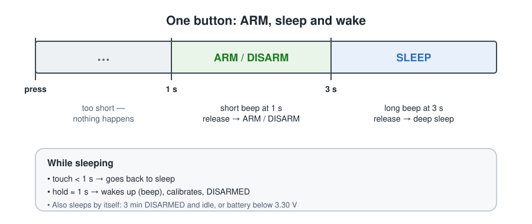
</p>

| Action | Result |
|---|---|
| Hold 1–3 s and release | Short beep at 1 s; on release the sensor arms or disarms. If not calibrated, calibration starts 1 s after release |
| Hold ≥ 3 s and release | Long beep at 3 s; on release it disarms, saves settings and sleeps |
| Touch < 1 s while asleep | Nothing: it goes straight back to sleep (protection against presses in a bag) |
| Hold ≈ 1 s while asleep | Beep, wake, calibration, DISARMED. The sensor registers with the hub again |
| 3 min disarmed with no presses or connections | Sleep |
| Battery < 3.30 V (three readings in a row) | If armed, the hub gets "low battery"; then the sensor sleeps |

## Signals and states

| Situation | Green | Red | Buzzer | Hub |
|---|---|---|---|---|
| Awake, disarmed | — | short flash every 5 s | short beep when disarming | — |
| Arming (SETTLING) | blinking | short flash every 5 s | — | — |
| Armed | on | short flash every 5 s | long beep when ARMED is reached | — |
| Deep sleep | — | — | — | — |
| **ARM cancelled**: the sensor moved during calibration | — | 3 flashes | 3 short beeps | — |
| Bite (event 1) | on | flash | short signal | screen + 300 ms vibration |
| Continuing bite (event 2) | on | repeated flashes | repeated signals | 800 ms vibration at the start of the episode |
| Rod being moved (pause) | — | — | silent | — |
| Battery ≤ 20 % while armed (event 3) | | | | screen + 2 short vibrations |
| Holding the button | | | beep at 1 s, long beep at 3 s | |

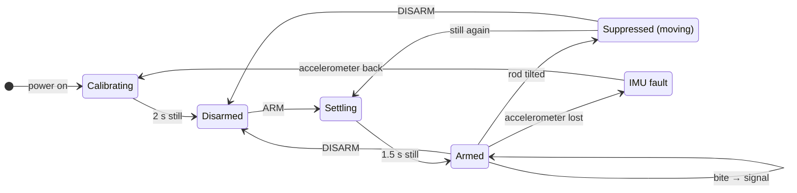

An accelerometer fault or a manual disarm **never** re-arms the sensor by itself; you arm it again yourself.

## Hub

After power-on the hub shows for about 20 seconds how many sensors it has seen, its own battery and, on the bottom line, **its MAC address** for pairing; then the screen turns off. A new bite or battery warning turns on the screen and the motor.

<table>
<tr>
<td align="center">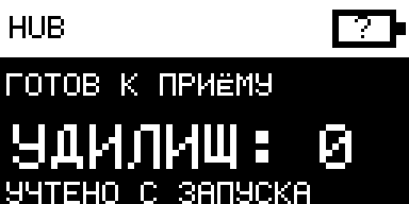<br>Ready to receive</td>
<td align="center">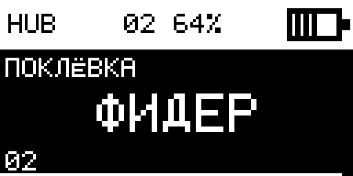<br>Bite on rod "ФИДЕР"</td>
</tr>
<tr>
<td align="center">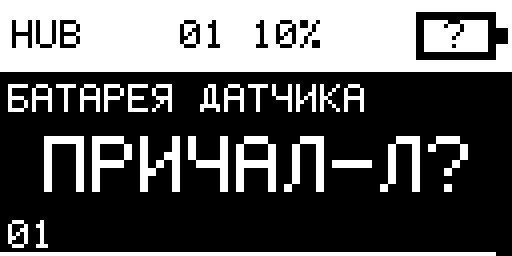<br>Sensor battery low</td>
<td align="center">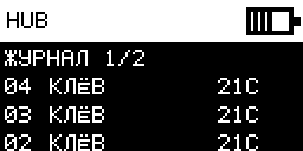<br>Event log (USB command)</td>
</tr>
</table>

<sub>Frames are produced by the hub's own drawing code (`ESP_HUB/tools/render_preview.py`) with example names. The hub's interface is in Russian.</sub>

**Hub button (D3):** hold 1.5 s for the hub MAC (30 seconds); short press for the status screen (another short press turns the screen off). Alerts always take priority.

<p align="center">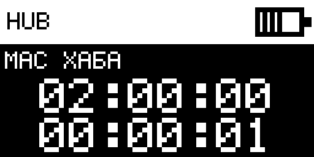</p>

- Rod numbers (01, 02, …) follow the order in which sensors first appear after the hub starts. After a hub restart the list and log start empty.
- List, log and service screens open with serial commands: `summary`, `list`, `history`, `service`, `mac`, `status`, `help`. `motor` runs the motor for 300 ms as a wiring test.
- More: [ESP_HUB/README.md](ESP_HUB/README.md), [docs/hub-testing.md](docs/hub-testing.md).

## Tuning sensitivity

1. Start with **High**.
2. Arm and tap the rod blank lightly or pull the line. If nothing happens, choose **Very high**.
3. Leave the rod on its rest for a few minutes, ideally in the wind. If false alarms appear, go one step lower.
4. The current threshold and wind level are shown over USB: `status` (`ambient`, `threshold`) and the journal line `ARMED: ambient … -> threshold …`.

### Wind and a swaying rod

Wind recordings (`docs/field-analysis-2026-11-24.md`) showed the wind shaking the rod about 5 times a second by ±0.2–0.3 g, while a bite is a short sharp jolt ringing at 15–30 Hz. So the sensor looks at **sharpness**: a filter removes everything slower than ~12 Hz, and the floor and multiplier come from the sensitivity step. The background level is the median sharpness over the last ~10 seconds (excluding the latest second), refreshed every half second in every state.

On the same recordings, through the firmware core, at "High": in strong wind the sensor arms and stays armed with no false alarm, catches 33 of 35 light simulated bites in calm and 19 of 24 taps in wind. Before: 35 false alarms a minute and 12 of 35.

Arming does not need complete stillness. A 1.5 s window is checked for **steadiness**:

| Check | Limit | Means |
|---|---|---|
| Position drift (first vs second half of the window) | 0.035 g (≈2°) | the rod is being moved to a new place |
| Peak-to-peak jolt on any axis | 0.20 g; in strong sway up to 6 × sway, never above 0.80 g | the sensor is being handled |
| Sway (standard deviation) | 0.15 g | wind too strong |

**Limitation:** a slow smooth pull (the fish draws the line steadily, without a jolt) is not seen by this detector. If such bites matter, a second channel based on the rod's tilt is needed, designed from recordings of slow pulls. If wind still causes false alarms, go one sensitivity step lower; if bites are missed, go one step higher.

## Battery

- Voltage is read every 5 seconds; the percentage is approximate (Li-ion curve).
- At ≤ 20 % while armed, the hub gets a warning (at most once a minute).
- Below 3.30 V the sensor goes into deep sleep to protect the cell.
- The goal is about 48 hours of operation, but current draw and real battery life **have not been measured yet**. How to measure it correctly: [docs/power-and-wiring.md](docs/power-and-wiring.md).

## Troubleshooting

| Problem | What to do |
|---|---|
| No `BiteSensor` network | The sensor is asleep: hold the button ~1 s. If it has been armed for over 2 minutes, Wi-Fi is already off: disarm with the button. If you renamed the network, look for the new name |
| Will not arm | Three short beeps mean the ARM was cancelled: the sensor moved during calibration (often a finger on the button or the board). Let go, wait 2–3 seconds and arm again. The `log` USB command shows the reason |
| "Sensor error" | Check the LSM6DS3 wiring (SDA D4, SCL D5, 3.3 V, GND). After recovery the sensor recalibrates by itself, but you must arm it again |
| Hub shows no bites | Check the hub MAC in *Settings*; the Hub row should say "Answered at power-on". Alarms go to the hub only while armed |
| Many false alarms | Go one sensitivity step lower; make sure the sensor is mounted firmly |
| Battery "no reading" | Normal when powered from USB without a cell |
| `storage=0` in the USB `status` | Flash cannot be read; settings work only until the next reboot. Do not format the flash, or old settings will be lost |

**Sensor USB commands** (serial monitor, 115200): `status` — state, `log` — journal of the last 32 events, `csv on` / `csv off` — stream every measurement (up to 104 Hz) for analysis, `sleep` — go to sleep, `register` — repeat hub registration, `peer AA:BB:CC:DD:EE:FF` — set the hub. `sleep`, `register` and `peer` work only while disarmed.

## For developers

```bash
python3 tools/run_host_tests.py
```

```bash
python3 ESP_HUB/tools/run_host_tests.py
```

```bash
pio run -e xiao_esp32c3 -e seeed_xiao_esp32s3 -e bite_v4_s3 -e s3_zero
```

```bash
pio run -d ESP_HUB -e xiao_esp32c3 -e seeed_xiao_esp32s3
```

- The detector is the portable `include/SensorCore.h`, shared by the firmware, the host tests and recording replay (`tools/replay_csv.py`).
- Hub packet (22 bytes, packed): `rodName[16]`, `eventType` (1 bite, 2 continuing, 3 battery), `batteryPct`, `deltaG`. Registration protocol: [docs/startup-registration.md](docs/startup-registration.md).
- Bench procedure, CSV capture, exact GPIOs: [docs/bench-testing.md](docs/bench-testing.md). Release scope: [docs/bench-release.md](docs/bench-release.md).
- The platform is pinned: `platformio/espressif32@8.0.0` (Arduino-ESP32 3.3.12); library versions are in `platformio.ini`.

### Not verified yet

Real fishing (real bites, other rods and winds, slow pulls), radio range, sleep current and battery life, PCB v4 and XIAO S3 hardware, the hub motor's physical vibration. Alarm delivery to the hub is not guaranteed: only the start-up registration is acknowledged. The open access point without a password is fine for the bench but is not secured.
