# 🎣 Датчик поклёвки (Fishing Bite Sensor)

[English](README.md)

**Беспроводной датчик поклёвки для удилища.** Небольшой датчик на удилище замечает даже слабые толчки лески, сразу подаёт сигнал светодиодом и зуммером, а по радио ESP-NOW сообщает о поклёвке на **хаб** — приёмник с экраном и вибромотором, который лежит рядом с вами. Роутер, интернет и приложение не нужны: все настройки открываются в браузере телефона.

<p align="center">
  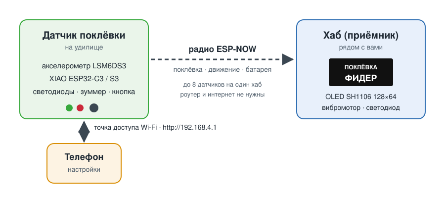
</p>

> **Статус проекта.** Это стендовая версия: прошивка проверена тестами и на настоящих платах XIAO ESP32-C3 (датчик + хаб), но **на реальной рыбалке ещё не испытывалась**. Точность распознавания поклёвок, дальность связи и время работы от аккумулятора пока не измерены.

## Содержание

- [Возможности](#возможности)
- [Что понадобится](#что-понадобится)
- [Подключение](#подключение)
- [Установка прошивки](#установка-прошивки)
- [Связка датчика с хабом](#связка-датчика-с-хабом)
- [Веб-интерфейс](#веб-интерфейс)
- [Как пользоваться на рыбалке](#как-пользоваться-на-рыбалке)
- [Кнопка, сон и пробуждение](#кнопка-сон-и-пробуждение)
- [Сигналы и состояния](#сигналы-и-состояния)
- [Хаб](#хаб)
- [Как настроить чувствительность](#как-настроить-чувствительность)
- [Батарея](#батарея)
- [Если что-то не работает](#если-что-то-не-работает)
- [Для разработчиков](#для-разработчиков)

## Возможности

**Датчик на удилище**

- 🎯 **Чувствительная детекция.** Акселерометр LSM6DS3 опрашивается 104 раза в секунду. Алгоритм *Dynamic XYZ* вычитает силу тяжести и реагирует на толчок в любом направлении, в том числе поперёк удилища.
- 🔇 **Защита от шума.** При включении датчик 2 секунды измеряет фоновые колебания и сам поднимает порог, если вокруг много вибраций (ветер, подставка).
- 🎣 **Пауза при перемещении.** Если вы взяли удилище в руки или наклонили его, тревоги временно отключаются. Когда удилище снова неподвижно в **новом** положении, охрана возвращается сама.
- 🔔 **Местные сигналы.** На охране горит зелёный светодиод, а красный коротко вспыхивает раз в 5 секунд: сразу видно, что датчик работает. Поклёвка — красный светодиод и зуммер. Громкость и яркость настраиваются.
- 📡 **Радио ESP-NOW на хаб.** Датчик передаёт три события: первая поклёвка, продолжающаяся поклёвка, разряд батареи.
- 📱 **Веб-настройка с телефона.** У датчика своя точка доступа Wi-Fi и страница `http://192.168.4.1` на русском или английском языке.
- 🔘 **Одна кнопка.** Включение и выключение охраны, глубокий сон и пробуждение.
- 🔋 **Экономия батареи.** Датчик засыпает по кнопке или сам, если 3 минуты не используется. Случайное касание кнопки в сумке его не будит. При разряде ниже 3,30 В датчик тоже засыпает, чтобы не испортить аккумулятор.
- 💾 **Настройки сохраняются** во флеш-памяти и не пропадают при обновлении прошивки.
- 🧾 **Журнал событий.** Датчик записывает, что и почему он решил: нажатия кнопки, калибровки, включение охраны. Журнал выводится по USB командой `log` и в «Подробностях».

**Хаб (приёмник)**

- 🖥️ Экран OLED 128×64 с русским шрифтом: крупное имя удилища, на котором клюёт.
- 📳 Вибромотор: разные сигналы для поклёвки, продолжающейся поклёвки и разряда батареи датчика.
- 🎣 До 8 датчиков на один хаб, журнал последних 12 событий.
- 🌙 Экран гаснет через 8 секунд и включается только при новой тревоге.
- 🔘 Кнопка: удержание 1,5 с показывает MAC хаба для связки с датчиком, короткое нажатие — экран состояния.

## Что понадобится

| Устройство | Компоненты | Примечание |
|---|---|---|
| **Датчик** | Seeed XIAO ESP32-C3 (стенд) или XIAO ESP32-S3 (плата v4), модуль LSM6DS3 (I²C), зелёный и красный светодиоды, пассивный зуммер (через транзистор), кнопка без фиксации, Li-ion аккумулятор 3,7 В, делитель 100 кОм / 100 кОм для измерения батареи | Также есть готовая плата KiCad v4.1 и корпус под 18650 в [`kicad/kicad_bite`](kicad/kicad_bite) |
| **Хаб** | XIAO ESP32-C3 или S3, OLED SH1106 128×64 (I²C), вибромотор через MOSFET, кнопка, светодиод, Li-ion аккумулятор, делитель 100 кОм / 100 кОм | Отдельная прошивка в [`ESP_HUB/`](ESP_HUB). Схема и детали: [docs/hub-hardware.md](docs/hub-hardware.md) |
| **Телефон** | Любой смартфон с Wi-Fi и браузером | Нужен только для настройки |
| **Компьютер** | [PlatformIO](https://platformio.org/install), USB-кабель Type-C | Для прошивки |

<p align="center">
  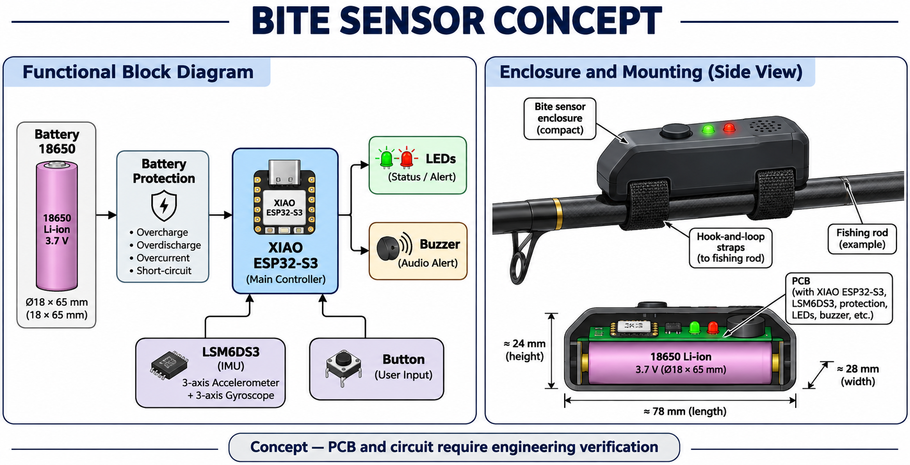
  <br><em>Концепция: датчик в компактном корпусе крепится к удилищу на липучках.</em>
</p>

<p align="center">
  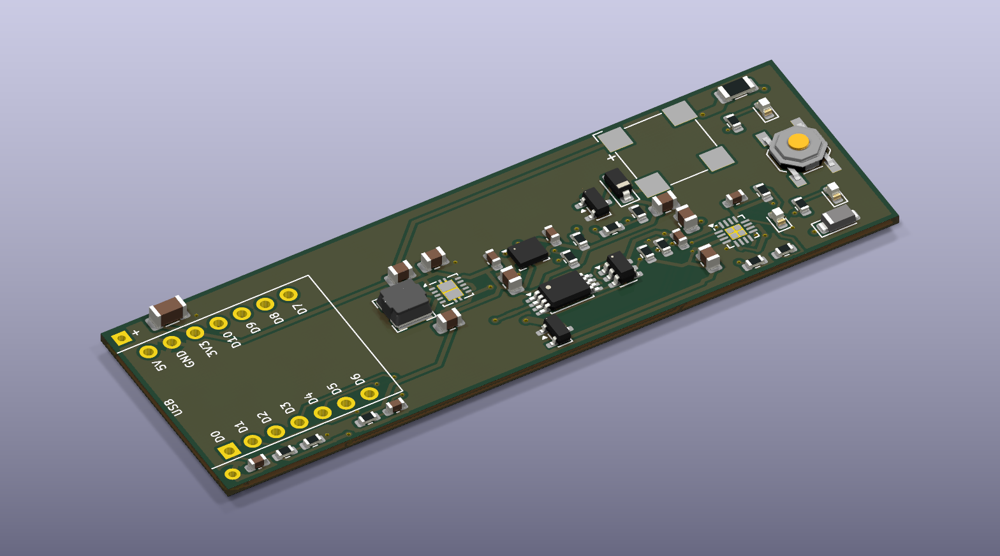
  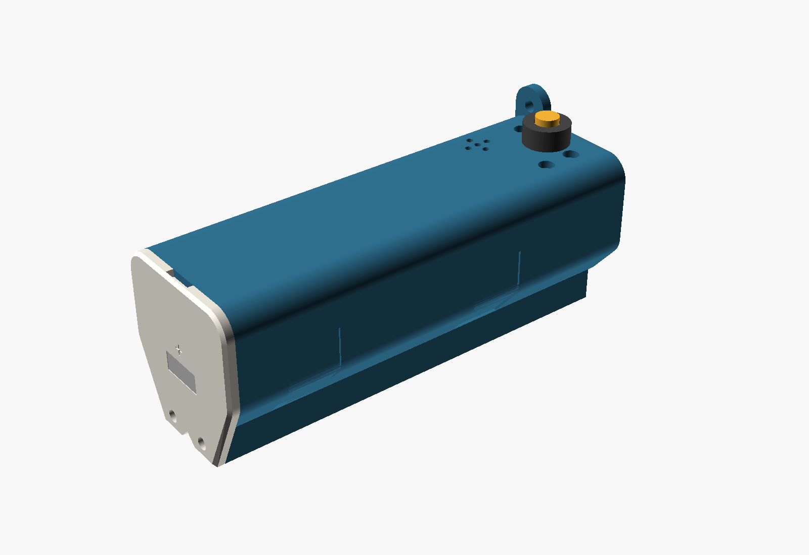
  <br><em>Плата v4.1 и герметичный корпус-трубка под аккумулятор 18650 (проект, ещё не изготовлен и не проверен).</em>
</p>

## Подключение

### Датчик — стенд (XIAO ESP32-C3 / S3)

| Сигнал | Вывод XIAO | Примечание |
|---|---|---|
| Кнопка | **D1** | Замыкает на GND; подтяжка внутренняя |
| Батарея (через делитель 100k/100k) | D2 | |
| LSM6DS3 SDA / SCL | D4 / D5 | Питание модуля 3,3 В |
| Зелёный светодиод | D7 | Через резистор или драйвер |
| Красный светодиод | D8 | Через резистор или драйвер |
| Пассивный зуммер | D9 | Через транзистор; ШИМ 3 кГц |

Кнопка должна быть на **D1**: от вывода D6 плата не может проснуться. Выводы D0 и D6 в текущей прошивке не используются.

### Датчик — плата v4 (XIAO ESP32-S3, окружение `bite_v4_s3`)

Кнопка D1 (внешний резистор 10k), батарея D0, красный светодиод D8, зелёный D9, зуммер D10, LSM6DS3 на D4/D5.

### Хаб

| Сигнал | Вывод XIAO |
|---|---|
| OLED SDA / SCL | D4 / D5 |
| Светодиод | D1 |
| MOSFET вибромотора | D2 |
| Кнопка (к GND) | D3 |
| Батарея (делитель 100k/100k) | A0 |

<p align="center">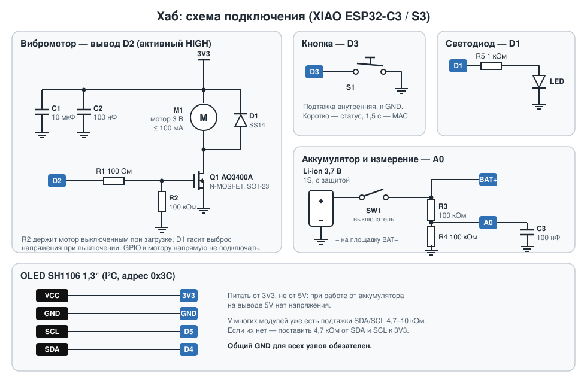</p>

Как выбрать и правильно подключить вибромотор, какие нужны детали: [docs/hub-hardware.md](docs/hub-hardware.md).

> ⚠️ Мотор и мощный зуммер подключайте только через транзистор, не напрямую к выводу. Li-ion аккумулятор подключается к площадкам **BAT+ / BAT−** платы XIAO, а не к 3V3. Подробнее о питании: [docs/power-and-wiring.md](docs/power-and-wiring.md).

## Установка прошивки

1. **Установите PlatformIO.** Подойдёт [PlatformIO IDE для VS Code](https://platformio.org/install/ide?install=vscode) или консольный [PlatformIO Core](https://docs.platformio.org/en/latest/core/installation/index.html). Проверьте, что команда `pio --version` работает.

2. **Скачайте проект.**

   ```bash
   git clone https://github.com/igorvin/Fishing-Bite-sensor-ESP.git
   ```

   ```bash
   cd Fishing-Bite-sensor-ESP
   ```

3. **Прошейте датчик.** Подключите плату датчика по USB и выберите окружение под свою плату. `<PORT>` — порт платы, например `/dev/ttyACM0` или `COM5`.

   | Плата | Окружение |
   |---|---|
   | XIAO ESP32-C3 (стенд) | `xiao_esp32c3` |
   | XIAO ESP32-S3 (стенд) | `seeed_xiao_esp32s3` |
   | Плата v4 (XIAO ESP32-S3) | `bite_v4_s3` |

   ```bash
   pio run -e xiao_esp32c3 -t upload --upload-port <PORT>
   ```

4. **Прошейте хаб.** Подключите **другую** плату — хаб — и выполните:

   ```bash
   pio run -d ESP_HUB -e xiao_esp32c3 -t upload --upload-port <PORT>
   ```

   Для XIAO ESP32-S3 используйте `-e seeed_xiao_esp32s3`.

> 💡 Будьте внимательны с портами: случайно залитая на датчик прошивка хаба (или наоборот) работать не будет. Для обычного обновления **не** выполняйте `erase_flash` и `uploadfs` — они стирают сохранённые настройки.

## Связка датчика с хабом

Датчик отправляет события только на хаб, MAC-адрес которого вы ему указали.

1. **Узнайте MAC хаба.** Он показывается в нижней строке стартового экрана 8 секунд после включения хаба. Удержание кнопки хаба 1,5 секунды показывает его крупными цифрами на 30 секунд. По USB: команда `mac` в мониторе порта хаба.

   ```bash
   pio device monitor -d ESP_HUB --port <PORT> --baud 115200
   ```

2. **Впишите MAC в датчик** одним из двух способов:
   - **С телефона:** откройте страницу *Настройки*, включите «ESP-NOW включён», введите MAC в поле «Unicast MAC хаба» и нажмите **«Сохранить сеть и перезапустить»**.
   - **По USB:** в мониторе порта датчика введите команду `peer AA:BB:CC:DD:EE:FF` (охрана должна быть выключена).

3. **Проверьте связь.** После перезапуска датчик представляется хабу. На странице *Статус* датчика в строке ESP-NOW появится «Регистрация при старте подтверждена», а команда `status` в мониторе порта хаба покажет `rods=1`. Порядок включения не важен: если перезапустить хаб, работающий датчик зарегистрируется заново.

> ℹ️ Регистрация — это разовое приветствие при включении, а не постоянная проверка связи. Подтверждения доставки каждой поклёвки нет. Перед рыбалкой проверьте, что тревога доходит до хаба: включите охрану и постучите по удилищу.

## Веб-интерфейс

1. Включите датчик (или разбудите его, удерживая кнопку ~1 с).
2. На телефоне подключитесь к Wi-Fi сети **`BiteSensor`** (так она называется при первом запуске; пароля нет).
3. Откройте в браузере **http://192.168.4.1**.

Вверху страницы есть меню **«Страница»** с тремя разделами: *Статус*, *Датчик* и *Настройки*. Обычные настройки сохраняются сразу после изменения — появляется сообщение «Сохранено».

<table>
<tr>
<td align="center" width="33%">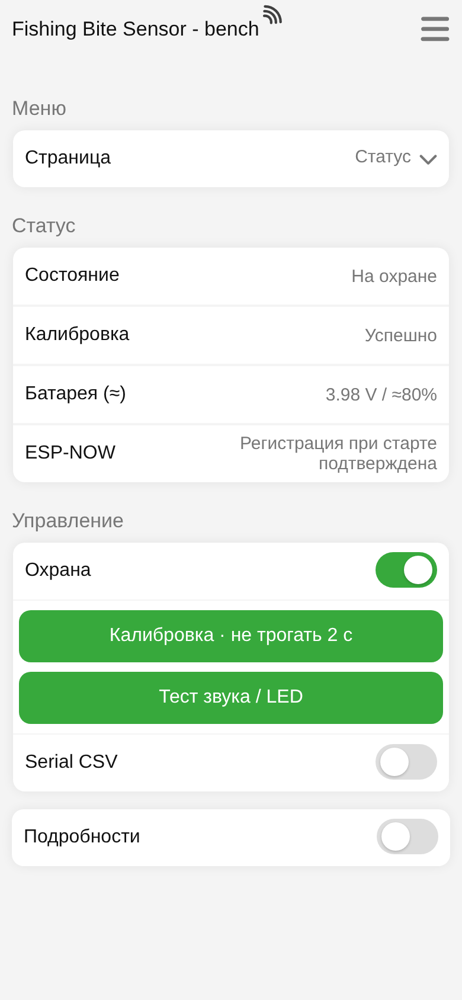<br><b>Статус</b></td>
<td align="center" width="33%">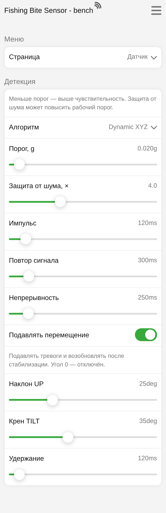<br><b>Датчик</b></td>
<td align="center" width="33%">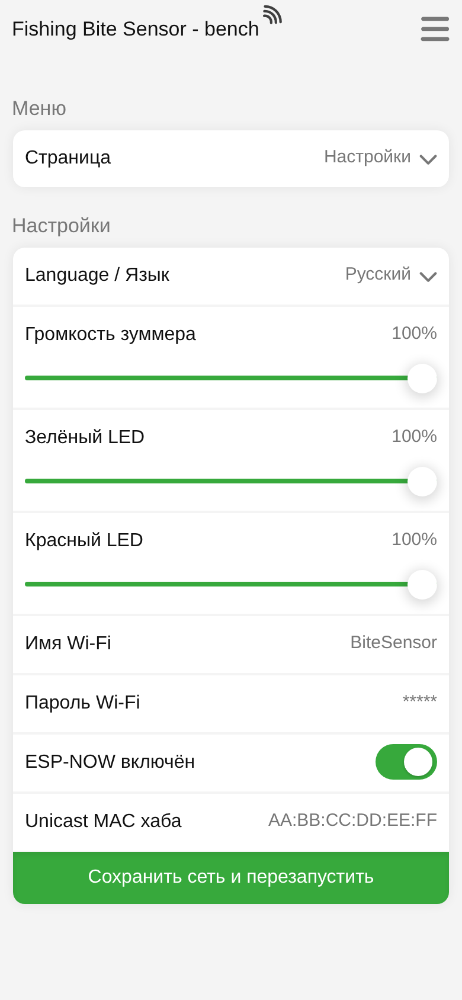<br><b>Настройки</b></td>
</tr>
</table>

<sub>Изображения сделаны в настоящем веб-интерфейсе прошивки (библиотека Settings 1.4.3) с примерными значениями; на устройстве цифры будут вашими.</sub>

### Статус

| Элемент | Что показывает или делает |
|---|---|
| **Состояние** | Выключена / Калибровка / Стабилизация / На охране / Движение: пауза / Ошибка IMU |
| **Калибровка** | Результат последнего замера фона: «Успешно» или «Отклонена: движение» |
| **Батарея (≈)** | Напряжение и примерный процент заряда. Если аккумулятор не подключён, показывается «Нет достоверного замера» |
| **ESP-NOW** | Выключен / Готов; хаб не подтверждён / Регистрация при старте подтверждена |
| **Охрана** | Включает и выключает охрану, как кнопка |
| **Калибровка · не трогать 2 с** | Заново измеряет фон. Держите датчик неподвижно 2 секунды |
| **Тест звука / LED** | Короткий сигнал зуммером и красным светодиодом. На хаб ничего не отправляется |
| **Serial CSV** | Запись всех замеров через USB для анализа |
| **Подробности** | Показывает технические данные (см. ниже) |

<details>
<summary><b>Технические данные (переключатель «Подробности»)</b></summary>
<p align="center">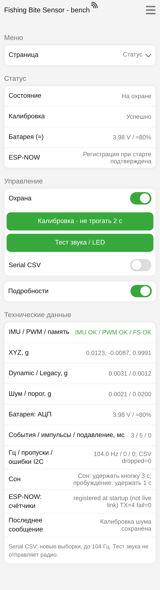</p>

- **IMU / PWM / память** — исправность акселерометра, выходов и флеш-памяти (зелёный цвет — всё в порядке).
- **XYZ, g** — текущее ускорение по трём осям.
- **Dynamic / Legacy, g** — сила текущего движения для обоих алгоритмов.
- **Шум / порог, g** — измеренный фон и рабочий порог срабатывания. Если порог поднят из-за шума, это будет указано.
- **События / импульсы / подавление** — счётчик поклёвок, сигналов и времени паузы при перемещении.
- **Гц / пропуски / ошибки I2C** — частота опроса датчика (около 104 Гц) и ошибки связи.
- **Сон**, **ESP-NOW: счётчики**, **Последнее сообщение** — служебная информация.
</details>

### Датчик (детекция)

| Настройка | По умолчанию | Описание |
|---|---|---|
| **Алгоритм** | Dynamic XYZ | *Dynamic XYZ* — рекомендуемый: реагирует на движение в любом направлении. *Legacy magnitude* — старый алгоритм, оставлен для сравнения |
| **Порог, g** | 0,020 | **Чем меньше, тем чувствительнее.** Диапазон 0,002–0,5 g |
| **Защита от шума, ×** | 4 | Рабочий порог не опускается ниже «фон × множитель». Больше — меньше ложных срабатываний |
| **Порог Legacy** | 0,15 | Виден только в режиме Legacy |
| **Импульс** | 120 мс | Длительность одного сигнала зуммера и красного светодиода |
| **Повтор сигнала** | 300 мс | Как часто повторяется сигнал при продолжающейся поклёвке |
| **Непрерывность** | 250 мс | Через сколько миллисекунд непрерывного движения поклёвка считается продолжающейся (событие 2) |
| **Подавлять перемещение** | вкл. | Пауза в тревогах, когда удилище берут в руки или наклоняют |
| **Наклон UP** | 25° | Наклон удилища вверх или вниз, после которого включается пауза. 0 — не проверять |
| **Крен TILT** | 35° | Поворот удилища вокруг своей оси, после которого включается пауза. 0 — не проверять |
| **Удержание** | 120 мс | Сколько наклон должен продержаться, чтобы включилась пауза |

### Настройки

| Настройка | Описание |
|---|---|
| **Language / Язык** | English или Русский |
| **Громкость зуммера** | 0–100 % |
| **Зелёный LED / Красный LED** | Яркость, 0–100 %. Уменьшите ночью, чтобы экономить батарею |
| **Имя Wi-Fi** | Имя точки доступа датчика. Оно же — имя удилища на экране хаба: хаб показывает первые 16 байт (около 8 русских или 16 латинских букв). Дайте каждому датчику своё имя: «Фидер», «Карп-1» |
| **Пароль Wi-Fi** | Пустой (без пароля) или от 8 до 63 символов |
| **ESP-NOW включён** | Разрешает отправку событий на хаб |
| **Unicast MAC хаба** | MAC-адрес хаба в формате `AA:BB:CC:DD:EE:FF` |
| **Сохранить сеть и перезапустить** | Применяет последние четыре поля. Пока кнопка не нажата, изменения в них не действуют |

## Как пользоваться на рыбалке

1. **Включите или разбудите датчик.** Удерживайте кнопку около 1 секунды, пока не прозвучит писк. Датчик сразу измеряет фон, поэтому **2 секунды держите его неподвижно**.
2. **Закрепите датчик на удилище** и установите удилище на подставку.
3. **Включите охрану.** Удерживайте кнопку 1–3 секунды: на 1-й секунде прозвучит короткий писк, после этого отпустите кнопку — раздастся сигнал подтверждения. Датчик 1,5 секунды ждёт, пока удилище успокоится (*Стабилизация*), затем загорается **зелёный светодиод**, а красный начинает коротко вспыхивать раз в 5 секунд — охрана включена. Если калибровка ещё не была выполнена, датчик сам начнёт её через 1 секунду после того, как вы отпустите кнопку (2 секунды не трогайте его).
4. **Поклёвка:** красный светодиод и зуммер на датчике, экран и вибрация на хабе. Пока леска дёргается, сигнал повторяется.
5. **Взяли удилище в руки?** Охрану выключать не обязательно: датчик ставит тревоги на паузу. Когда удилище снова неподвижно, охрана возвращается сама — уже в новом положении.
6. **Выключите охрану** тем же удержанием кнопки 1–3 секунды: зелёный светодиод погаснет, прозвучит короткий писк.
7. **Сон.** Удерживайте кнопку дольше 3 секунд (прозвучит длинный писк) и отпустите. Если датчик 3 минуты лежит без охраны и к нему никто не подключён, он засыпает сам.

> 💡 Пока охрана включена, Wi-Fi датчика работает ещё 2 минуты, потом отключается для экономии энергии. Чтобы снова открыть настройки, выключите охрану кнопкой — точка доступа включится снова.

## Кнопка, сон и пробуждение

<p align="center">
  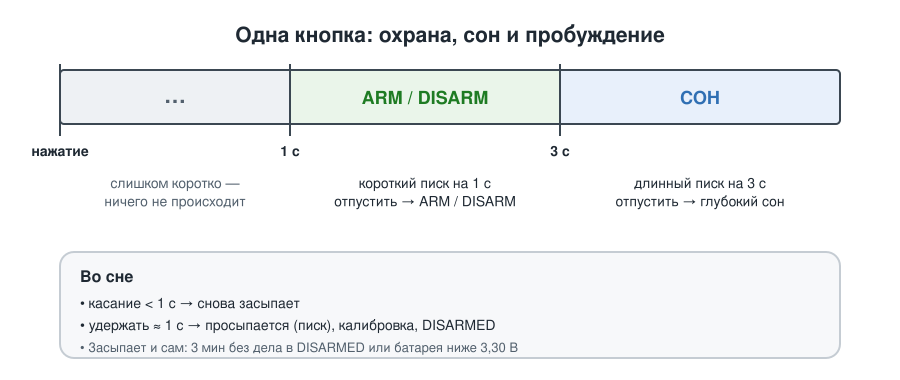
</p>

| Действие | Результат |
|---|---|
| Удержать 1–3 с и отпустить | Короткий писк на 1-й секунде; после отпускания охрана включается или выключается. Если датчик не откалиброван, калибровка начнётся через 1 с после отпускания |
| Удержать ≥ 3 с и отпустить | Длинный писк на 3-й секунде; после отпускания охрана снимается, настройки сохраняются, датчик засыпает |
| Во сне коснуться < 1 с | Ничего: датчик сразу засыпает снова (защита от нажатий в сумке) |
| Во сне удержать ≈ 1 с | Писк, пробуждение, калибровка, состояние «Выключена». Датчик заново представляется хабу |
| 3 мин без охраны, без нажатий и подключений | Сон |
| Батарея < 3,30 В (три замера подряд) | Если охрана была включена, хаб получает «разряд батареи», затем датчик засыпает |

## Сигналы и состояния

| Ситуация | Зелёный | Красный | Зуммер | Хаб |
|---|---|---|---|---|
| Охрана выключена | — | — | короткий писк при выключении | — |
| Охрана включена | горит | короткая вспышка раз в 5 секунд | писк при включении | — |
| **Охрана отменена**: датчик двигался во время калибровки | — | 3 вспышки | 3 коротких писка | — |
| Поклёвка (событие 1) | горит | вспышка | короткий сигнал | экран + вибрация 300 мс |
| Продолжающаяся поклёвка (событие 2) | горит | повторные вспышки | повторные сигналы | вибрация 800 мс в начале эпизода |
| Удилище перемещают (пауза) | — | — | тихо | — |
| Батарея ≤ 20 % при охране (событие 3) | | | | экран + 2 коротких вибрации |
| Удержание кнопки | | | писк на 1 с, длинный писк на 3 с | |

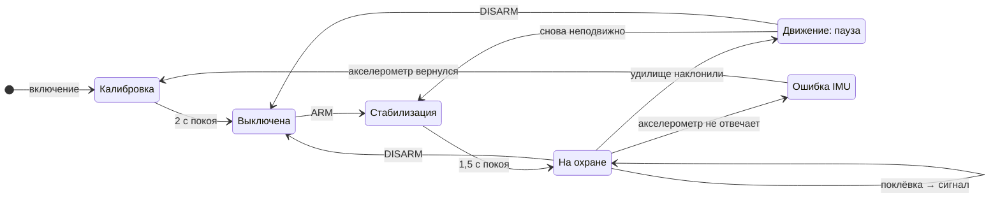

Ошибка акселерометра или ручное выключение **никогда** не включают охрану сами по себе: после них охрану нужно включить вручную.

## Хаб

После включения хаб около 8 секунд показывает, сколько датчиков он учёл, заряд своей батареи и в нижней строке **свой MAC-адрес** для связки с датчиком, затем экран гаснет. Новая поклёвка или предупреждение о батарее включают экран и вибромотор.

<table>
<tr>
<td align="center">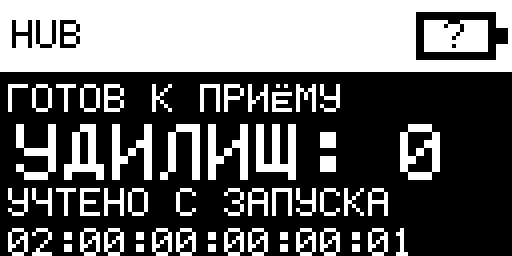<br>Готов к приёму</td>
<td align="center">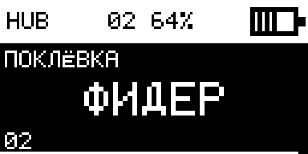<br>Поклёвка на «ФИДЕР»</td>
</tr>
<tr>
<td align="center">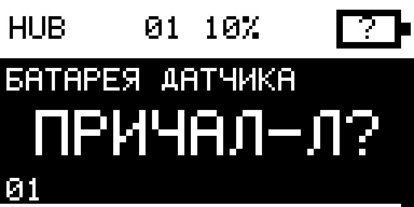<br>Разряжена батарея датчика</td>
<td align="center">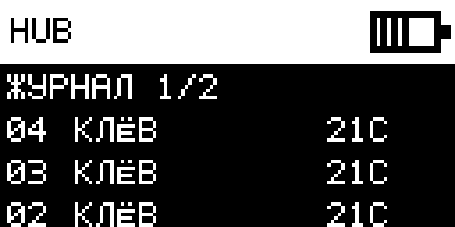<br>Журнал (по USB-команде)</td>
</tr>
</table>

<sub>Кадры сгенерированы тем же кодом отрисовки, что работает в хабе (`ESP_HUB/tools/render_preview.py`), с примерными именами.</sub>

**Кнопка хаба (D3):** удержание 1,5 с — MAC хаба на 30 секунд, короткое нажатие — экран состояния (повторное короткое нажатие гасит экран). Тревога всегда важнее.

<p align="center">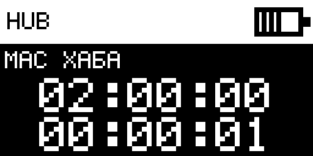</p>

- Номер удилища (01, 02, …) присваивается в порядке первого появления после включения хаба. После перезапуска хаба список и журнал начинаются заново.
- Экраны списка, журнала и сервиса открываются командами в мониторе порта: `summary`, `list`, `history`, `service`, `mac`, `status`, `help`. Команда `motor` включает мотор на 300 мс для проверки.
- Подробнее: [ESP_HUB/README.md](ESP_HUB/README.md), [docs/hub-testing.md](docs/hub-testing.md).

## Как настроить чувствительность

1. Начните со значений по умолчанию: **Dynamic XYZ, порог 0,020 g, защита от шума ×4**.
2. Включите охрану и легко постучите пальцем по бланку или потяните леску. Если сигнала нет, уменьшайте порог постепенно (0,015 → 0,010 …).
3. Оставьте удилище на подставке на несколько минут, лучше на ветру. Если есть ложные срабатывания, увеличьте порог или множитель шума.
4. В *Подробностях* сравните строки «Шум / порог»: если рядом с порогом написано «порог повышен шумом», ваш порог ниже фона и реально не используется.
5. Если пауза при перемещении срабатывает от ветра, увеличьте углы UP и TILT или время удержания.

## Батарея

- Напряжение измеряется каждые 5 секунд, процент заряда примерный (по кривой Li-ion).
- При заряде ≤ 20 % и включённой охране хаб получает предупреждение (не чаще одного раза в минуту).
- Ниже 3,30 В датчик уходит в глубокий сон, чтобы защитить аккумулятор.
- Цель — около 48 часов работы, но ток потребления и реальное время работы **ещё не измерены**. Как правильно измерить: [docs/power-and-wiring.md](docs/power-and-wiring.md).

## Если что-то не работает

| Проблема | Что сделать |
|---|---|
| Нет сети `BiteSensor` | Датчик спит: удерживайте кнопку ~1 с. Если охрана включена дольше 2 минут, Wi-Fi уже выключен — выключите охрану кнопкой. Если имя сети меняли, ищите сеть с новым именем |
| Охрана не включается | Три коротких писка означают, что охрана отменена: во время калибровки датчик двигался (часто — от пальца на кнопке или на плате). Отпустите датчик, подождите 2–3 секунды и включите снова. Причину покажет команда `log` по USB или «Последние события» в *Подробностях* |
| «Ошибка IMU» | Проверьте провода LSM6DS3 (SDA D4, SCL D5, 3,3 В, GND). После восстановления датчик откалибруется сам, но охрану нужно включить вручную |
| Хаб не показывает поклёвки | Проверьте MAC хаба и переключатель «ESP-NOW включён»; на *Статусе* должно быть «Регистрация при старте подтверждена». Тревоги уходят на хаб только при включённой охране |
| Много ложных срабатываний | Увеличьте порог или множитель шума, проверьте, что датчик жёстко закреплён |
| «Нет достоверного замера» батареи | Нормально при питании только от USB без аккумулятора |
| «FS ERROR» в подробностях | Флеш-память не читается, настройки работают только до перезагрузки. Не форматируйте память, чтобы не потерять старые настройки |

**USB-команды датчика** (монитор порта, 115200): `status` — состояние, `log` — журнал последних 32 событий, `sleep` — заснуть, `register` — повторить регистрацию на хабе, `peer AA:BB:CC:DD:EE:FF` — задать хаб. Команды `sleep`, `register` и `peer` работают только при выключенной охране.

## Для разработчиков

```bash
python3 tools/run_host_tests.py
```

```bash
python3 ESP_HUB/tools/run_host_tests.py
```

```bash
pio run -e xiao_esp32c3 -e seeed_xiao_esp32s3 -e bite_v4_s3
```

```bash
pio run -d ESP_HUB -e xiao_esp32c3 -e seeed_xiao_esp32s3
```

- Алгоритм детекции — переносимый `include/SensorCore.h`. Его используют и прошивка, и тесты, и воспроизведение записей: `tools/replay_csv.py`.
- Формат пакета на хаб (22 байта): `rodName[16]`, `eventType` (1 — поклёвка, 2 — продолжается, 3 — батарея), `batteryPct`, `deltaG`. Протокол регистрации: [docs/startup-registration.md](docs/startup-registration.md).
- Стендовые испытания, запись CSV, подробные пины: [docs/bench-testing.md](docs/bench-testing.md). Состав выпуска: [docs/bench-release.md](docs/bench-release.md).
- Платформа закреплена: `platformio/espressif32@8.0.0` (Arduino-ESP32 3.3.12), версии библиотек указаны в `platformio.ini`.

### Что ещё не проверено

Реальная рыбалка (слабые поклёвки, ветер, ложные тревоги), дальность радиосвязи, ток во сне и время работы от батареи, работа платы v4 и XIAO S3 «в железе», физическая вибрация хаба. Гарантированной доставки тревоги на хаб нет: подтверждается только регистрация при включении. Открытая точка доступа без пароля подходит для стенда, но не защищена.
