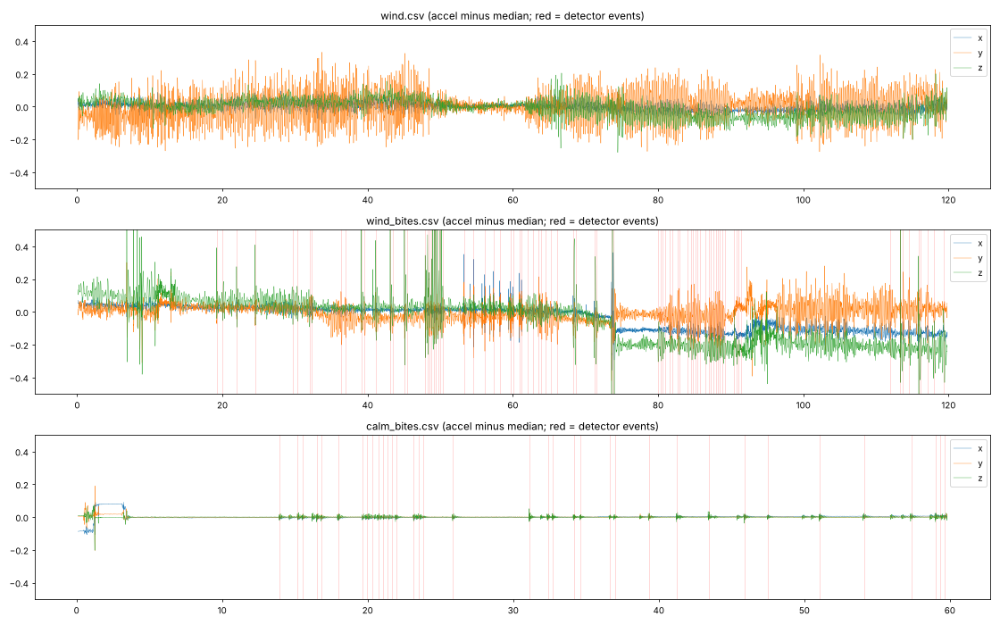
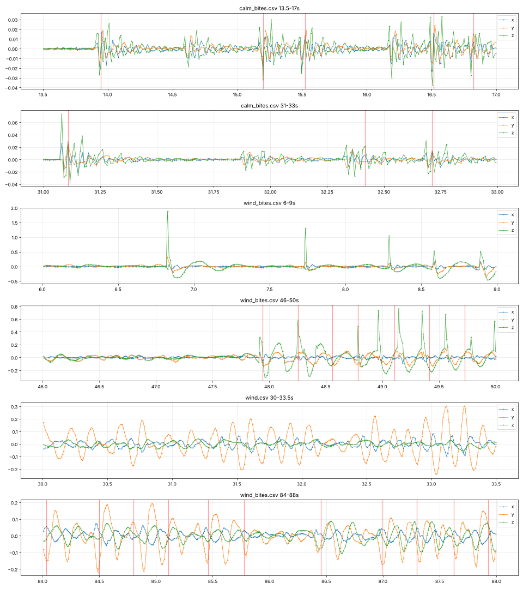

# Полевые записи 2026-11-24: ветер и имитации поклёвок

Записи: `tests/fixtures/field/wind.csv` (ветер, 2 мин, без касаний), `wind_bites.csv` (ветер + имитации, 2 мин), `calm_bites.csv` (тишина + имитации, 1 мин). Отметки времени имитаций не записались; поклёвки найдены по данным. При запуске скрипта записи датчик перезагружался (исправлено в `tools/capture_csv.py`). Частота отсчётов фактически около 111 Гц (шаг 9 мс), пропусков нет.

## Что видно

- **Ветер — не медленное качание, а колебания около 5 Гц** (полоса 4–8 Гц), ±0,2–0,3 g, в основном по одной оси. Похоже на собственную частоту удилища/подставки. SD всего сигнала 0,108 g — вдвое выше нынешнего предела охраны 0,05 g.
- **Имитации поклёвок — резкие импульсы**: в тишине «звон» 0,02–0,04 g на 15–30 Гц, затухающий за 0,2–0,3 с; в ветре — пики 0,5–1,9 g длиной 1–2 отсчёта.
- Ветер плавный от отсчёта к отсчёту, поклёвка резкая. Разделять нужно по **резкости** (высоким частотам), а не по силе.

## Признаки (максимум за 2 мин чистого ветра против поклёвок)

| Признак | Ветер, max | Лёгкие поклёвки в тишине, max | Постукивания в ветер |
|---|---|---|---|
| Сейчас: \|a − g\| (НЧ 500 мс) | 0,361 g | 0,079 g | до 1,9 g |
| Резкость: \|ВЧ-фильтр 12 Гц\| | 0,152 g | 0,066 g | до 1,2 g |

## Сравнение детекторов на этих записях

| Детектор | Ложные тревоги в ветер | Лёгкие поклёвки в тишине (35) | Сильные постукивания в ветер (24) |
|---|---|---|---|
| Нынешняя прошивка, через `tools/replay_csv.py` (ядро прошивки) | `wind.csv`: охрана не включается (SD 0,108 > 0,05); `wind_bites.csv`: 35 срабатываний/мин | 12 | 12 |
| Симуляция: огибающая \|ВЧ 12 Гц\| (максимум за 5 отсчётов), порог = max(0,012 g; 6 × медиана огибающей за последние 10 с без последней 1 с), обновление каждые 0,5 с | 0 | 33 (лишних 0) | 19 |

Нынешний детектор пропускает лёгкие поклёвки и в тишине: он требует 20 мс подряд выше порога, а короткий «звон» этого не даёт. Порог, зафиксированный при включении охраны, в порывистый ветер то слишком низкий (затишье при включении → ложные тревоги), то слишком высокий.

## Ограничения вывода

- Одна сессия, одно удилище, один ветер; параметры подобраны на тех же данных (риск переобучения).
- Нет отметок времени: «сильные постукивания» определены по второй разности > 0,5 g, лёгкие поклёвки в ветре не размечены.
- ВЧ-фильтр по построению не видит **медленных потяжек** (рыба плавно тянет леску). Если такие поклёвки важны, нужен второй канал (устойчивое смещение положения удилища, которого ветер-колебание не даёт) и записи медленных потяжек.
- 5 Гц — частота именно этого удилища; у другого удилища она будет другой, проверять надо на нескольких.

## Внедрено (2026-11-24)

Детектор резкости встроен в ядро (`include/SensorCore.h`, класс `Impulse`), ступени чувствительности пересчитаны (`include/Sensitivity.h`), пределы устойчивости расширены (SD ≤ 0,15 g, размах ≤ 0,80 g). Результат ядра прошивки на этих записях (`tools/replay_csv.py --skip-ms 4000 --sensitivity N`, тревога = событие 1 или 2):

| Ступень | `wind.csv`: охрана / ложные тревоги | Лёгкие в тишине (35) | Постукивания в ветер (24) |
|---|---|---|---|
| Низкая | включается / 0 | 14 | 17 |
| Ниже средней | включается / 0 | 24 | 18 |
| Средняя | включается / 0 | 31 | 19 |
| **Высокая** | включается / 0 | 33 | 19 |
| Очень высокая | включается / 0 | 33 (+1 лишняя) | 19 |

Регрессионный тест `field-2026-11-24-wind-and-bites` в `tests/test_core.cpp` следит, чтобы ветер оставался без тревог на всех ступенях, а лёгкие поклёвки в тишине — с тревогами.

## Исправлено: загрубление при частых поклёвках (2026-11-24)

По логу после прошивки и на `calm_bites.csv`: серия поклёвок 13,5–23,5 с занимала около половины 10-секундного окна, медиана огибающей («фон») росла в ~5 раз, и на «Очень высокой» порог поднимался с 0,009 до 0,035 g. Следующие поклёвки (например, 0,026 g на 25,9 с) пропускались.

Теперь отсчёты поклёвки не попадают в фон: отсчёт помечается, когда огибающая достигла текущего порога, и ещё 300 мс «звона» после. Чтобы ветер по-прежнему поднимал порог, пометка снимается, если одна «поклёвка» длится дольше 1,5 с без паузы (это уже непрерывная вибрация) или если помечено больше 75 % окна. Результат ядра (`tools/replay_csv.py --skip-ms 4000`):

| | До | После |
|---|---|---|
| `calm_bites.csv`, Очень высокая: максимальный порог в ARMED | 0,0348 g | 0,0094 g |
| `calm_bites.csv`, Высокая: максимальный порог в ARMED | 0,0418 g | 0,0120 g |
| `wind.csv`, все ступени: ложные тревоги | 0 | 0 |
| Склейка «тишина → сильный ветер» (Очень высокая): тревоги после начала ветра | ~7 с | ~7,5 с |

Тесты `frequent-bites-keep-preset-threshold` и `onset-of-continuous-vibration-still-adapts`. Константы подобраны на тех же записях; на реальной рыбалке не проверено.
