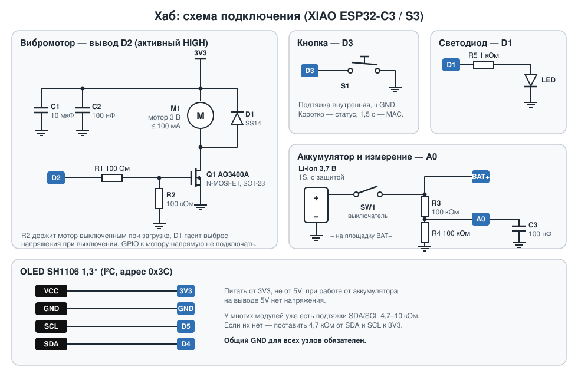
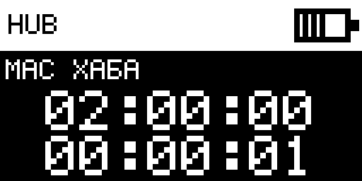

# Хаб: вибромотор, кнопка и будущая плата

Схема для ручной сборки (макет или навесной монтаж). Она же — техническое задание для будущей платы хаба. Прошивка уже поддерживает все узлы: мотор на D2, светодиод на D1, кнопку на D3, OLED на D4/D5, измерение батареи на A0.

| Узел | Вывод XIAO | Примечание |
|---|---|---|
| Вибромотор (через MOSFET) | D2 | Активный HIGH |
| Светодиод (через 1 кОм) | D1 | Горит, пока включён экран |
| **Кнопка (к GND)** | **D3** | Новая. Подтяжка внутренняя |
| OLED SDA / SCL | D4 / D5 | SH1106 128×64, адрес 0x3C или 0x3D |
| Делитель батареи 100k/100k + 100 нФ | A0 | |

## Вибромотор

### Какой мотор взять

- **Рекомендую:** плоский мотор-«монетку» (ERM) диаметром 10 мм и толщиной 2,7–3 мм: типовые 1027 или 1030, 3 В, 60–90 мА. Он тонкий, приклеивается к стенке корпуса и даёт хорошо ощутимую вибрацию в кармане.
- **Сильнее:** цилиндрический мотор с эксцентриком (например, 4×8 мм или 6×12 мм). Его труднее закрепить, и потребляет он больше, обычно 100–150 мА. Тогда транзистор и диод нужны с запасом по току (детали ниже подходят).
- **Не нужен:** линейный мотор LRA. Для него требуется отдельный драйвер (например, DRV2605L), а для сигнала поклёвки хватает обычного ERM.

### Почему нужен транзистор

Вывод ESP32 рассчитан на единицы–десятки миллиампер, а мотор при старте берёт около 100 мА и больше. Кроме того, при выключении обмотка мотора даёт выброс напряжения. Подключение мотора прямо к выводу может испортить ESP32. Поэтому мотор включается транзистором-ключом, а выброс гасит диод.

### Детали

| Обозн. | Деталь | Зачем |
|---|---|---|
| Q1 | N-MOSFET **AO3400A** (SOT-23), логический уровень | Ключ: полностью открывается уже от 2,5 В на затворе |
| R1 | 100 Ом | Ограничивает ток перезаряда затвора, гасит звон |
| R2 | 100 кОм, затвор → GND | Держит мотор выключенным, пока ESP32 загружается и вывод D2 «висит» |
| D1 | Диод Шоттки **SS14** (или 1N5819) параллельно мотору, катод к +3V3 | Гасит выброс напряжения при выключении |
| C1, C2 | 10 мкФ + 100 нФ возле мотора, от +3V3 на GND | Убирают просадку питания при пуске мотора, чтобы не сбрасывался ESP32 и не моргал OLED |
| M1 | Мотор 3 В, до ~100 мА | |

Для макетной платы, если нет MOSFET в корпусе SOT-23, подойдёт NPN-транзистор S8050 или 2N2222 с резистором **1 кОм** в базе вместо R1. R2 тогда не нужен, D1 и C1/C2 остаются. **Не используйте** 2N7000 и IRF540/IRFZ44: от 3,3 В они открываются плохо.

### Питание мотора

Подключайте плюс мотора к **3V3**, а не к аккумулятору. Мотор рассчитан на 3 В, а свежий аккумулятор даёт 4,2 В. От 3V3 сила вибрации одинаковая при любом заряде. Конденсаторы C1/C2 обязательны: без них пусковой ток мотора проседает по питанию всей платы. Если ESP32 перезагружается или OLED гаснет в момент вибрации, увеличьте C1 до 47–100 мкФ.

### Механика

- Приклейте мотор **плоской стороной к стенке корпуса** (у «монеток» обычно есть двусторонний скотч). Так вибрация передаётся корпусу, и она хорошо чувствуется в кармане. На плате рядом с OLED мотор вибрирует хуже и трясёт разъёмы.
- Выводы мотора очень тонкие: закрепите провода клеем или термоусадкой у самого мотора.
- Мотор ставьте подальше от антенны XIAO.

### Прошивка и проверка

Прошивка хаба уже управляет мотором на D2 (HIGH — вибрация) и не блокирует радио:

| Событие | Вибрация |
|---|---|
| Поклёвка (событие 1) | 300 мс |
| Новый эпизод продолжающейся поклёвки (событие 2) | 800 мс |
| Разряд батареи датчика (событие 3) | 2 × 150 мс |

Для проверки без датчика откройте монитор порта хаба и введите `motor`: мотор включится на 300 мс. Ток можно измерить мультиметром в разрыве плюса мотора. Если он выше 100 мА, увеличьте C1 и проверьте, что ESP32 не перезагружается.

## Кнопка

Кнопка без фиксации между **D3** и **GND**. Внешний резистор не нужен, подтяжка включена в прошивке. На плате удобно поставить ту же тактовую кнопку, что и на датчике (TL3342), и 100 нФ параллельно для защиты от помех, если провод длинный.

| Действие | Результат |
|---|---|
| Удержать **1,5 с** | На 30 секунд показывается **MAC хаба** крупными цифрами, затем экран гаснет |
| Коротко нажать | Показывается экран состояния (число удилищ, батарея хаба). Если какой-то экран уже открыт, он закрывается |
| Тревога во время показа | Тревога имеет приоритет, потом экран MAC возвращается до конца своих 30 с |

MAC также доступен по USB: команды `mac` и `status`. Строка `Hub MAC:` при запуске часто теряется, потому что после сброса USB переподключается, и монитор открывается уже после неё.

## Плата хаба: план

Плата датчика (`kicad/kicad_bite`) собрана генератором, который запускает KiCad, Freerouting и Java на macOS. Плату хаба логично сделать тем же способом: сначала схема из этого документа, затем раскладка, трассировка, DRC и Gerber-файлы.

Предлагаемый состав платы:

| Узел | Деталь |
|---|---|
| Модуль | XIAO ESP32-C3 или S3 (как на датчике, пайка штыревыми рядами) |
| Мотор | AO3400A, 100 Ом, 100 кОм, SS14, 10 мкФ + 100 нФ, две площадки под провода мотора |
| Кнопка | TL3342 (SMD) на D3, 100 нФ |
| Светодиод | 0603 + 1 кОм на D1 |
| Батарея | Разъём JST-PH 2P, движковый выключатель в разрыв BAT+, делитель 100k/100k + 100 нФ на A0 |
| Экран | Гребёнка 4 pin под модуль SH1106 1,3″ (VCC, GND, SCL, SDA), питание от 3V3 |

Прежде чем рисовать плату, нужно решить:

1. **Корпус и размер.** Плата под размер модуля OLED (около 35×33 мм, экран поверх платы «бутербродом») или отдельный корпус?
2. **Аккумулятор.** Плоский LiPo (например, ваш 1200 мА·ч) или 18650, как в датчике? От этого зависят высота корпуса и разъём.
3. **Зарядка.** Встроенная зарядка XIAO через USB-C или отдельная, как на плате датчика (BQ24074)?
4. **Плата XIAO.** C3 или S3?
5. **Герметичность.** Хаб лежит рядом с рыбаком — нужен ли корпус, переживающий дождь?
