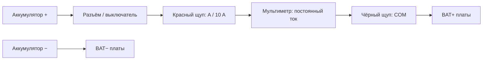

# Питание и предварительный замер

Цель — около 48 часов для датчика и хаба; **она не подтверждена**. Пользователь отложил замеры. На фото аккумуляторы 3,7 В / 300 мА·ч / 1,11 Вт·ч и 3,7 В / 1200 мА·ч / 4,44 Вт·ч. Это маркировка, а не проверенная фактическая ёмкость. Для 48 часов теоретический средний ток от батареи не более 6,25 мА и 25 мА соответственно; с условным запасом 20% — около 5 и 20 мА.

## Схема для подтверждённой XIAO ESP32-C3

Во время измерения USB полностью отключён. Мультиметр включается **последовательно**, никогда между плюсом и минусом питания. Начальный диапазон и гнёзда выбираются по инструкции конкретного прибора. Для обычной работы мультиметр заменяется прямым соединением. Провода/разъём паяются к обесточенной плате, аккумулятор при пайке отсоединён; сам элемент паять не требуется.

Батарейные площадки XIAO предназначены для подходящего одноэлементного литиевого аккумулятора, номинал 3,7 В: [официальная документация C3](https://wiki.seeedstudio.com/XIAO_ESP32C3_Getting_Started/). Не подключать элемент к GPIO или 3V3 вместо BAT. Полярность проверяется по маркировке именно своей платы. При питании от BAT наличие 5 В на выводе VBUS/5V не гарантируется: существующее питание OLED и его допустимое напряжение нужно проверить до испытания от аккумулятора, не меняя проводку вслепую.

По присланным фото не установлены состояние аккумуляторов, параметры защиты и допустимый зарядный ток. Совместимость встроенной зарядки платы с выбранным элементом нужно проверить отдельно; одновременное подключение USB и аккумулятора запускает другой режим питания/зарядки и не годится для этого замера.

## Что изменено в прошивке HU02

- Хаб показывает готовность и число учтённых в этой загрузке удилищ около 8 с, затем выключает OLED и статусный LED. Поклёвка будит экран, после очереди тревог он снова выключается.
- Нет автоматического перелистывания в ожидании, heartbeat или постоянного опроса датчиков. Список/журнал доступны по USB-командам и не вращаются сами.
- У исправного погашенного OLED не идут повторные I2C-пробы или опрос АЦП батареи. Измерение возобновляется при событии/просмотре; ограниченные попытки восстановления неисправного радио/OLED остаются, чтобы вернуть основную функцию.
- Радиоприём хаба остаётся непрерывным. Выключать его по неподтверждённому расписанию означало бы рисковать пропусками. CPU/радио и датчик всё ещё требуют дальнейшей энергетической проверки; этот выпуск **не является доказательством 48 часов**.
- USB-индикация/логирование, подключённый ПК, периферия и реальный аккумулятор меняют расход; обычный мультиметр может пропускать короткие пики передачи.
