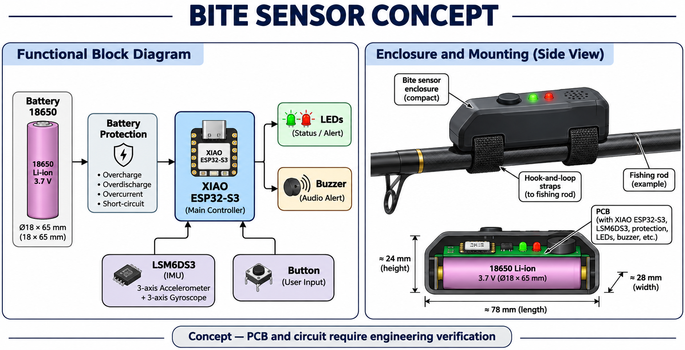
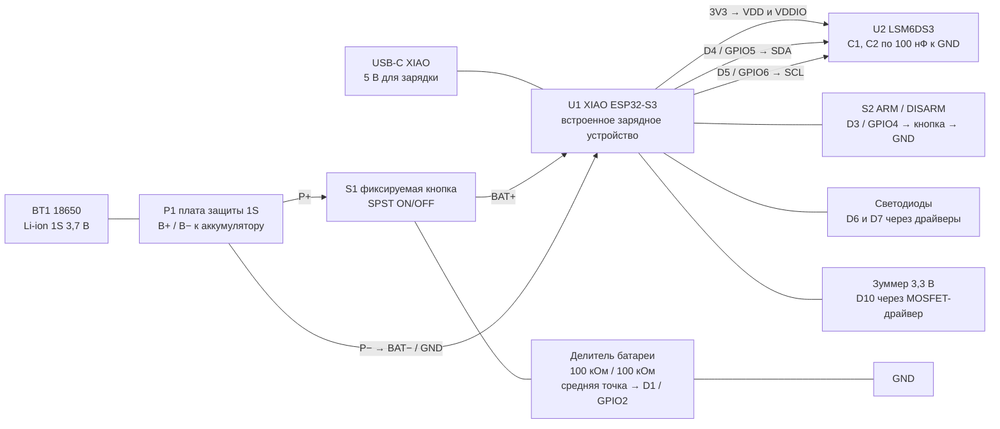

# Датчик поклёвки с аккумулятором 18650

На рисунке показана идея крепления. Размеры корпуса ориентировочные. Ниже — черновая электрическая схема для XIAO ESP32-S3 и отдельной микросхемы LSM6DS3. Номиналы и посадочные места перед изготовлением требуют проверки.

U2 при I²C требует подтяжки SDA и SCL к 3,3 В, CS к 3,3 В и определённого уровня SA0. Номиналы подтяжек уточняются при проверке разводки. Выводы SDx и SCx, неиспользуемые контакты и развязка питания должны быть подключены согласно выбранному режиму LSM6DS3 и его документации.

S1 разрывает положительную линию между защитой аккумулятора и BAT+ XIAO. Для зарядки через встроенный USB-C XIAO кнопку необходимо включить. При подключённом USB плата может оставаться включённой независимо от S1. P1 подбирается под однобаночный Li-ion и требования аккумулятора. Полярность, допустимый ток зарядки и ревизию XIAO необходимо подтвердить до сборки.

Кнопка S2 управляет охраной и отделена от S1. Назначения выводов на черновике требуют отдельного профиля прошивки. Существующая прошивка стенда использует другие GPIO.

Источники: [Seeed XIAO ESP32-S3](https://wiki.seeedstudio.com/xiao_esp32s3_getting_started/), [ST LSM6DS3](https://docs.arduino.cc/resources/datasheets/LSM6DS3-datasheet.pdf).
