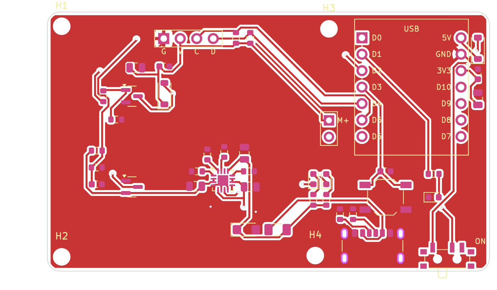
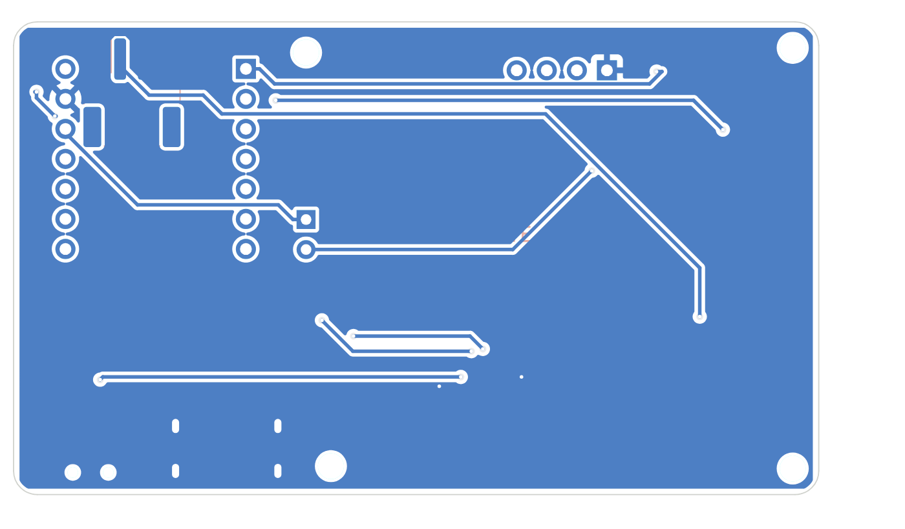
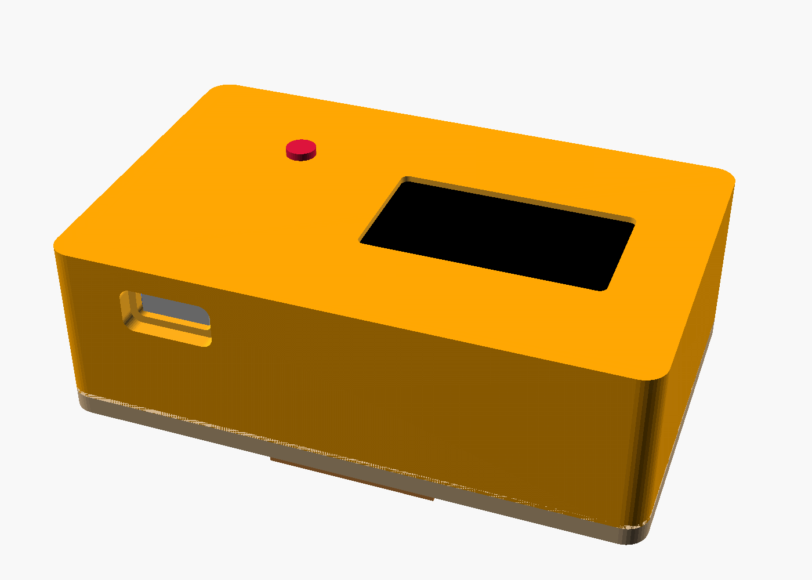
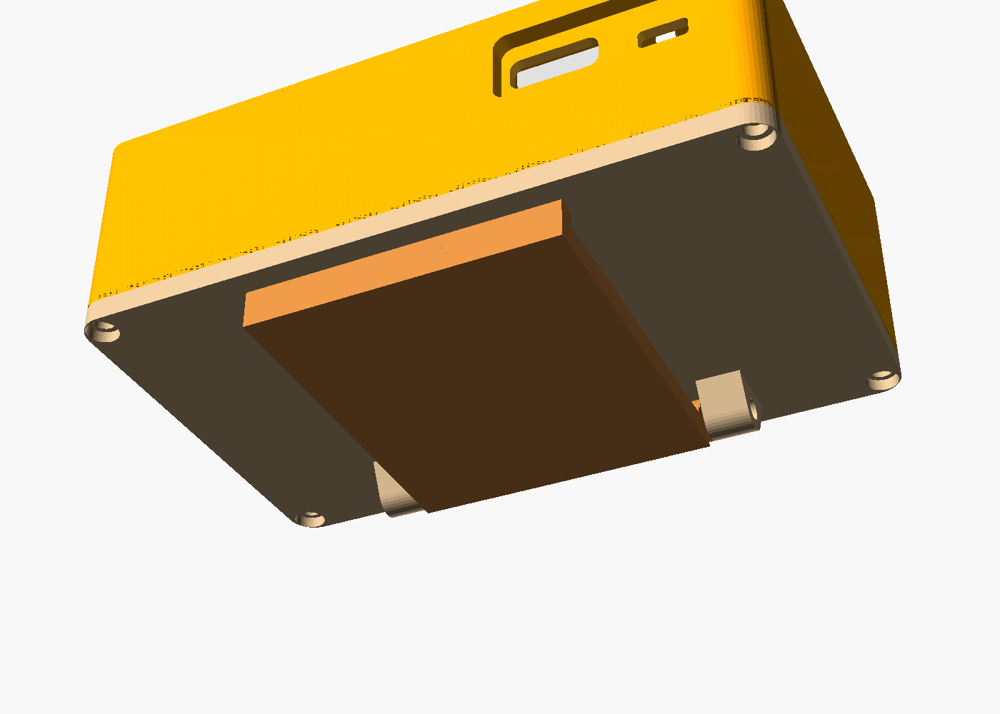

# Плата и корпус хаба, rev A (черновик, 2026-11-25)

Плата 68 × 40 мм под XIAO ESP32-C3, модуль OLED SH1106 1,3″, вибромотор, кнопку и плоский LiPo 1200 мА·ч с быстрой зарядкой BQ24074. Корпус «бипер» 75 × 47 × 24 мм с откидной клипсой: сложенная держит хаб на ремне, откинутая служит подставкой на столе (с клипсой толщина 30 мм).

**Статус:** проект собран генератором и проверен программно (нетлист, DRC, проверка посадки в корпусе). Ничего не заказано и не собрано. Перед заказом надо сверить с даташитами пункты из раздела «Проверить до заказа».

| | |
|---|---|
|  |  |
|  |  |

## Файлы

| Файл | Что это |
|---|---|
| `hub.kicad_sch`, `hub_schematic.pdf`, `docs/img/schematic-1.png` | схема (формат KiCad 7, открывается в KiCad 8/9) |
| `hub.kicad_pcb` | разведённая плата, 2 слоя, 1,0 мм, заливка GND с обеих сторон |
| `hub.pretty`, `hub.kicad_sym` | свои посадочные места (XIAO, OLED на гребёнке, площадки мотора) и символ XIAO ESP32-C3 |
| `fab/hub_gerbers.zip` | Gerber + сверловка для заказа платы |
| `fab/hub-bom.csv`, `fab/hub-pos.csv` | перечень деталей и координаты для монтажа |
| `fab/hub.step` | 3D-модель платы (детали без моделей — только площадки) |
| `docs/drc_report.txt` | DRC: 0 ошибок, 0 неразведённых; 2 предупреждения — шёлкография библиотечного SW1 выходит за край (так задумано: рычажок свешивается) |
| `enclosure/hub_enclosure.scad` | параметрическая модель корпуса (OpenSCAD), размеры в начале файла |
| `enclosure/stl/*.stl` | детали для печати |
| `_generator/` | генератор: схема → плата → Freerouting → заливка → DRC → файлы производства |

## Схема

Питание: **USB-C J1 → F1/VD1 → BQ24074 → SYS → выключатель SW1 → диод D3 → вывод 5V XIAO → стабилизатор XIAO 3,3 В** → OLED, мотор, светодиод.

- **Зарядка BQ24074:** ток заряда ≈ 0,59 А (R3 = 1,5 кОм, 0,5C для 1200 мА·ч, полная зарядка ≈ 2,5 ч), входной ток ≈ 1 А (R4 = 1,5 кОм). Power-path: от USB хаб работает и во время зарядки. TS — резистор 10 кОм вместо NTC (температура аккумулятора не контролируется). Светодиоды: красный D1 «заряжается», зелёный D2 «USB подключён», видны через глухие окна в корпусе.
- **USB-C J1** — только питание (CC1/CC2 через 5,1 кОм), данных нет. Прошивка — через USB-C самой XIAO на верхнем торце.
- **Аккумулятор** — разъём JST-PH 2P J2 снизу платы. Q1 (AO3401A) защищает от разъёма с обратной полярностью (у китайских LiPo она встречается). **Аккумулятор должен быть со своей платой защиты**: отдельной защиты от переразряда на плате нет.
- **SW1** разрывает питание XIAO, зарядка работает и при выключенном хабе. **D3** не даёт USB XIAO питать зарядник в обратную сторону, поэтому оба USB можно подключать одновременно (проверить на первом образце).
- **Выводы как в прошивке `ESP_HUB`** (ничего менять не нужно): светодиод D1, мотор D2 (AO3400A, диод D4, 10 мкФ + 100 нФ), кнопка D3 к GND, OLED D4/D5 (подтяжки 4,7 кОм), делитель батареи 100k/100k на A0.

## Корпус

| Деталь | Материал / печать |
|---|---|
| `shell.stl` — оболочка с экраном | **полупрозрачный (натуральный) или белый PETG**: светодиоды светят через глухие окна 0,6 мм. Печать экраном вниз |
| `cover.stl` — задняя крышка с рамкой аккумулятора, кольцом мотора и петлями клипсы | PETG, наружной стороной вниз |
| `clip.stl` — клипса/подставка | PETG (гнётся без излома), на боку |
| `pusher.stl` — толкатель кнопки | PETG |
| `flap.stl` — заглушка USB-C зарядки и выключателя | **ТПУ 85–95A** |
| `plug_top.stl` — пробка USB-C XIAO | ТПУ |
| `gasket.stl` — плоская прокладка крышки 0,8 мм | ТПУ 85A |

Защита от воды «от дождя и брызг»: прокладка по шву крышки, толкатель кнопки с O-кольцом 2,5 × 1,0 в отверстии Ø4,1, окно экрана — пластина 34,6 × 20,6 × 1 мм (акрил или поликарбонат) вклеена изнутри на силикон, светодиоды без отверстий, оба USB-C под ТПУ-заглушками. Погружение не предусмотрено.

Клипса крепится винтом M2 × 45 (или отрезком прутка 2 мм) через три петли с самоконтрящейся гайкой: затяжкой регулируется, насколько туго она откидывается. Сложенная, она оставляет под ремень зазор 3,2 мм с зацепом на конце. Откинутая примерно на 42°, она упирается выступом в крышку и держит хаб на столе.

Сборка: плата крепится четырьмя саморезами M2 × 5 снизу к бобышкам оболочки; аккумулятор лежит в рамке крышки, между ним и платой 2 мм под головки винтов и выводы (проложить каптон или изоленту); крышка — четыре самореза M2 × 8 по углам.

## Предположения (уточнить, сейчас не измерено)

1. **LiPo 50 × 34 × 10 мм** (типовой 1200 мА·ч). Другой размер меняется параметром `BAT` в `.scad`; толщина больше 10 мм увеличит корпус.
2. **Модуль OLED 1,3″ 35,4 × 33,5 мм, выводы GND-VCC-SCL-SDA** на верхнем краю. Бывают модули с VCC и GND наоборот — тогда плату нужно поменять (или резать дорожки). Окно `WIN` 31 × 17 мм по центру модуля — сверить с реальным стеклом.
3. Модуль OLED стоит над платой на гребёнке с зазором 3,5 мм; детали под ним не выше 1,3 мм.
4. Ток хаба не измерен; 1200 мА·ч по оценке хватит на 14–18 ч.

## Проверить до заказа

- BQ24074: формулы ISET/ILIM (K_ISET = 890, K_ILIM = 1550 взяты по памяти), назначение вывода 15 (SYSOFF у BQ24074; R6 0 Ом на GND, при необходимости не ставить), таймер TMR оставлен свободным.
- Посадочное место XIAO (`hub:XIAO_THT`) — по чертежу Seeed: 14 площадок, шаг 2,54, ряды 15,24 мм.
- Полярность разъёма аккумулятора: 1 = «+» (по маркировке на нижнем слое).
- Ориентация JST J2 и SW1 на реальных деталях, вылет рычажка SW1 за край платы (~1 мм).

## Пересборка

```sh
# Linux (Ubuntu 24.04): apt install kicad kicad-symbols kicad-footprints openscad xvfb
bash kicad/kicad_hub/_generator/run_hub.sh        # схема, плата, трассировка, DRC, Gerber, BOM (~3 мин)
bash kicad/kicad_hub/enclosure/build.sh           # STL, картинки, проверка посадки (~1 мин)
```

На macOS с KiCad 8/9 задать `KPY` и `KICAD_CLI` (см. начало `run_hub.sh`). Freerouting 2.1 скачивается сам. Трассировщик не детерминирован: скрипт повторяет трассировку, пока DRC не покажет 0 неразведённых площадок, поэтому дорожки при каждой пересборке немного разные.
